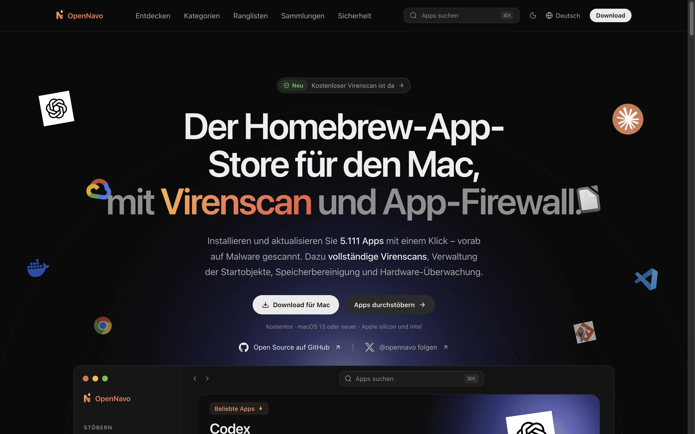
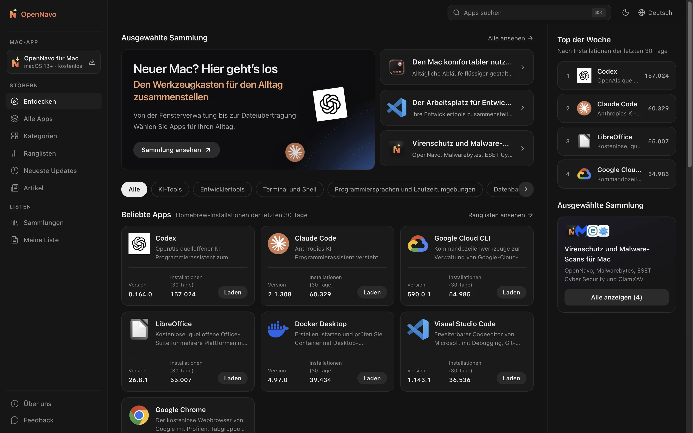
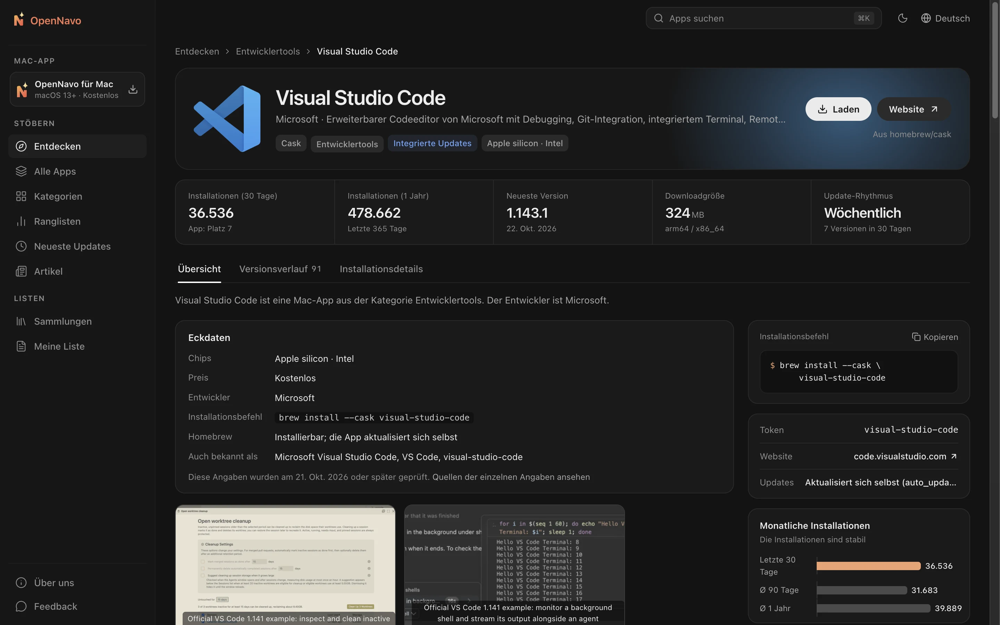
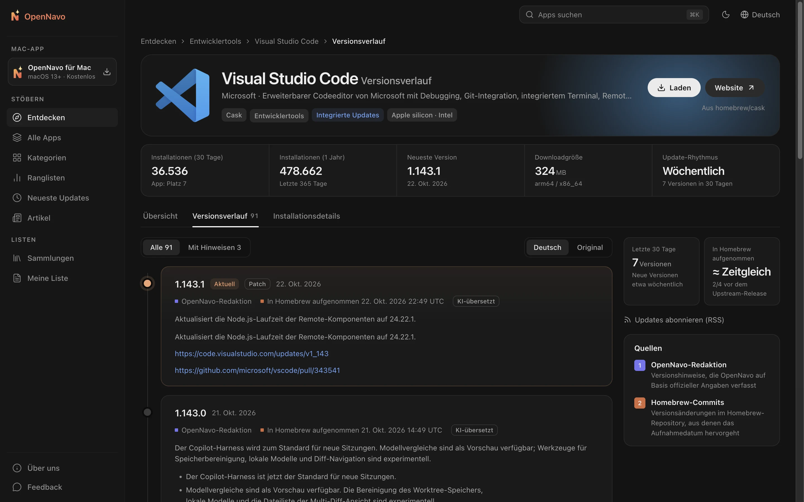

<div align="center">


# OpenNavo

[English](../../README.md) · [简体中文](README.zh-CN.md) · [日本語](README.ja-JP.md) · [Español](README.es-ES.md) · [Português (Brasil)](README.pt-BR.md) · [Русский](README.ru-RU.md) · **Deutsch** · [Français](README.fr-FR.md) · [Italiano](README.it-IT.md) · [繁體中文](README.zh-Hant.md)

**Der Homebrew-App-Store für Mac**

Entdecken Sie Beschreibungen und Versionshinweise zu über 7.700 Homebrew Casks,<br>
und installieren oder aktualisieren Sie Apps mit einem Klick im macOS-Client. Homebrew führt jeden Schritt aus, und Sie können alles mitverfolgen.

[](../../LICENSE)


[Website](https://opennavo.com/de) · [Apps entdecken](https://opennavo.com/de/discover) · [Herunterladen](https://opennavo.com/de/download) · [Mitwirken](#mitwirken)



</div>

## Einführung

<!-- brand-definition -->
OpenNavo ist ein kostenloser, quelloffener grafischer Homebrew-Client für Mac, mit dem Sie Homebrew-Apps auf Ihrem Mac mit einem Klick installieren und aktualisieren können; die zugehörige Website ist ein Verzeichnis von Mac-Apps mit Versionsverläufen, Systemanforderungen und Anleitungen zur Deinstallation.
<!-- /brand-definition -->

Homebrew ist eine zuverlässige Möglichkeit, Software auf einem Mac zu installieren. Doch die Kommandozeile ist nicht für alle geeignet, und `brew outdated` verrät nicht, was sich geändert hat. OpenNavo ergänzt Homebrew Cask um eine App-Store-Oberfläche:

- **Web**: Apps durchsuchen, suchen und vergleichen, Versionshinweise lesen und Installationsbefehle kopieren.
- **macOS-Client**: Alle Funktionen der Website sowie Installation und Updates über Homebrew auf Ihrem eigenen Mac, gründliche Deinstallation von Apps aus beliebigen Quellen, vorsichtige Bereinigung von Caches und Restdateien, Systemüberwachung in der Menüleiste und ein Protokoll aller Vorgänge.
- **Sprachen**: Die Website unterstützt zehn Sprachen: English, 简体中文, 繁體中文, 日本語, Español, Português (Brasil), Русский, Deutsch, Français und Italiano. Der macOS-Client unterstützt ebenfalls alle zehn; die Verwaltung verwendet sechs davon: English, 简体中文, 日本語, Español, Português (Brasil) und Русский. App-Beschreibungen und Versionshinweise werden automatisch übersetzt; der Originaltext bleibt jederzeit verfügbar.
- **Kein Konto erforderlich**: Keine Registrierung und keine Anmeldung. Einfach öffnen und loslegen.

[opennavo.com](https://opennavo.com/de) verwendet den Code aus diesem Repository.

## Funktionen

### Web

- **Entdecken**: Kategorien, Ranglisten nach tatsächlichen Installationszahlen, redaktionelle Empfehlungen und Sammlungen.
- **Suche**: Englische und chinesische Namen, Pinyin und Aliasnamen. Zum Beispiel findet `weixin` WeChat und `vscode` Visual Studio Code. Überall mit <kbd>⌘</kbd> <kbd>K</kbd> aufrufbar.
- **App-Details**: Beschreibungen, Screenshots, Installationszahlen und Aktualisierungsrhythmus, Abhängigkeiten und Konflikte, Installationspfade und Deinstallationsverhalten.
- **Versionshinweise**: Änderungen jeder Version als Zeitleiste, einschließlich des Aufnahmedatums in Homebrew und einer Umschaltung zwischen Übersetzung und Original.
- **Brewfile**: Apps beim Stöbern zur Liste hinzufügen und mit einem Klick ein Brewfile erstellen. Sammlungen lassen sich direkt exportieren.
- **Im Client öffnen**: Die Installation über `opennavo://`-Deep-Links an den macOS-Client übergeben.

### macOS-Client

- **Mit einem Klick installieren, aktualisieren und deinstallieren**: Aufgaben laufen in einer Warteschlange mit Live-Fortschritt und den tatsächlich ausgeführten brew-Befehlen. Bei Fehlern können Sie Protokolle prüfen und den Vorgang wiederholen.
- **Apps aus beliebigen Quellen deinstallieren**: Apps von Homebrew, aus dem App Store, aus Disk-Images und .pkg-Installationen werden mit Größe und letztem Öffnungszeitpunkt aufgelistet. Vor dem Entfernen prüfen Sie jede gefundene zugehörige Datei, etwa App-Daten, Caches, Einstellungen, Hintergrundobjekte und Installationsbelege. Standardmäßig landen Dateien im Papierkorb, sodass Sie die Aktion rückgängig machen können.
- **Mac bereinigen**: Ein rein lesender Scan findet App-Caches, Protokolle, Browser- und Entwickler-Caches, Homebrew-Downloads und alte Versionen sowie Reste bereits gelöschter Apps. Er erfasst auch alte temporäre Dateien, nicht mehr benötigte Installationspakete, Build-Dateien von seit einem Monat unberührten Projekten, Papierkorb, Geräte-Backups und Xcode-Archive sowie den von Docker freigebbaren Speicher. Die Ergebnisse sind nach Risiko gruppiert: neu erzeugbare Dateien werden direkt gelöscht, Restdateien und Installationspakete kommen in den Papierkorb, und persönliche Dateien werden nicht vorausgewählt. Caches laufender Apps werden übersprungen.
- **Systemüberwachung**: CPU, GPU, Arbeitsspeicher, Laufwerke, Netzwerk, Batterie, Temperaturen und Lüfter auf einen Blick. Dazu kommen Diagramme der letzten Minute oder Stunde, CPU- und GPU-Leistungsaufnahme, Laufwerkszustand (SMART) und die Prozesse mit der höchsten CPU-, Speicher-, Laufwerks- oder Netzwerkauslastung. Jede Kennzahl kann als eigener Menüleisteneintrag erscheinen, ohne Mengenbegrenzung (CPU und Arbeitsspeicher sind standardmäßig aktiviert), als Text oder kleines Diagramm. Ein Klick zeigt die Details direkt darunter. Optionale Warnungen informieren über Auffälligkeiten. Lüfterdrehzahlen sind jederzeit sichtbar; der Helfer für manuelle Steuerung lässt sich mit einem Klick im Client oder in der Menüleiste installieren. Messwerte bleiben im Arbeitsspeicher Ihres Mac und werden weder hochgeladen noch auf die Festplatte geschrieben.
- **Update-Verwaltung**: Geplante Prüfungen und Updates für alle Apps mit einem Klick, einschließlich Apps mit eigenen Updates (`auto_updates`) und fixierten Apps. Vor dem Aktualisieren laufender Apps werden Sie um Zustimmung gebeten.
- **Lokales Aktivitätsprotokoll**: Jede Installation, Aktualisierung und Deinstallation wird erfasst und kann exportiert werden.
- **Einfacher Einstieg**: Homebrew-Umgebung erkennen und Unterstützung bei der Installation erhalten. Mit einem Klick zwischen Spiegelservern in China wechseln: Tsinghua TUNA, USTC und Alibaba Cloud.
- **Weitere Funktionen**: Menüleistenbetrieb, Brewfile-Import und -Export, Offline-Katalog und Updates für OpenNavo selbst.

### Verwaltung und Inhalte

- Kategorien, Texte in allen Website-Sprachen, Symbole und Akzentfarben, Screenshots, Empfehlungen, Sammlungen, Terminologie und Client-Mitteilungen verwalten.
- Versionshinweise und Übersetzungen, Synchronisierungsaufgaben, Suchanalysen, Feedback, Client-Versionen, Spiegelserver und Remote-Konfiguration verwalten. Mit Administratoren, Rollen und Berechtigungen sowie Audit-Protokollen. Änderungen lassen sich wiederherstellen; gelöschte Inhalte landen zunächst im Papierkorb.
- Integrierter [MCP](https://modelcontextprotocol.io)-Dienst: KI-Agenten können App-Inhalte innerhalb ihrer Berechtigungen pflegen. Alle Schreibvorgänge unterstützen Probeläufe (dry run).

## Screenshots

<table>
  <tr>
    <td width="50%"></td>
    <td width="50%"></td>
  </tr>
  <tr>
    <td align="center">Entdecken: Kategorien, beliebte Apps und aktuelle Updates</td>
    <td align="center">Details: Beschreibungen, Kennzahlen und Installationsbefehle</td>
  </tr>
  <tr>
    <td colspan="2"></td>
  </tr>
  <tr>
    <td colspan="2" align="center">Versionshinweise: Änderungen jeder Version und Aufnahmedatum in Homebrew</td>
  </tr>
</table>

## Wie der Client Homebrew verwendet

Der Client führt Befehle auf Ihrem Computer aus. Klare Sicherheitsgrenzen haben deshalb Vorrang:

- **Der Server führt niemals brew aus**. Installationen, Updates und Deinstallationen werden vom Client auf Ihrem Mac gestartet.
- **Ohne Shell**: brew wird mit einem Argument-Array aufgerufen. Paketnamen müssen eine Positivlistenprüfung bestehen, um das Einschleusen von Befehlen zu verhindern.
- **Nur Casks**: brew-Befehle für bestimmte Apps enthalten ausdrücklich `--cask`. Schreibvorgänge für Formulae werden abgelehnt.
- **Vorsichtige Deinstallation**: Apps, die nicht über Homebrew installiert wurden, entfernt OpenNavo selbst und führt dabei weder deren Deinstallationsprogramme noch Installationsskripte aus. Zugehörige Dateien werden anhand von Bundle-ID, App Group, Hintergrundobjekten, Installationsbelegen und Homebrews zap-Regeln ermittelt. Dateien mit nur ähnlichen Namen oder solche, die andere Apps ebenfalls verwenden, sind nicht vorausgewählt. Jeder Pfad wird unmittelbar vor dem Entfernen erneut geprüft; symbolischen Links wird nicht gefolgt. Objekte mit Administratorbedarf werden nach einer einzigen macOS-Passwortabfrage gemeinsam entfernt; Homebrew kann für eigene Schritte separat nachfragen. Mit macOS gelieferte Apps werden nicht aufgelistet.
- **Vorsichtige Bereinigung**: Die Bereinigung prüft nur feste Orte: Cache-, Protokoll- und Entwicklerverzeichnisse, temporäre Ordner, Downloads und Schreibtisch, Projektordner, Papierkorb und Geräte-Backups sowie Reste nach den Deinstallationsregeln. Docker-Images, Build-Cache und gestoppte Container werden ausschließlich über Docker-Befehle entfernt; Volumes werden nie zur Bereinigung angeboten. Browserverlauf, Cookies, Passwörter und Erweiterungen bleiben unberührt, ebenso Schlüsselbunde, Passwortmanager, VPN- und KI-Werkzeuge, virtuelle Maschinen und iCloud Drive. Weitere Inhalte können Sie einer Schutzliste hinzufügen. Jedes Objekt wird vor dem Entfernen erneut geprüft; symbolischen Links wird nicht gefolgt und Administratorrechte werden nicht angefordert.
- **Vorsichtige Lüftersteuerung**: Ein kleiner Helfer akzeptiert nur fünf festgelegte Befehle und ausschließlich von OpenNavo. Lüfter werden nie ausgeschaltet; ihre Drehzahl bleibt zwischen Systemminimum und -maximum. Sie kehren zur Systemsteuerung zurück, wenn OpenNavo beendet wird, abstürzt oder 15 Sekunden nicht reagiert, wenn der Mac schläft oder ein Schreibvorgang fehlschlägt. Hitze verhindert die manuelle Steuerung nicht; bleibt die Chiptemperatur 10 Sekunden lang bei mindestens 95 °C, laufen manuell gesteuerte Lüfter mit voller Drehzahl.
- **Sie entscheiden**: Jeder über einen Web-Deep-Link angeforderte Schreibvorgang erfordert vor der Ausführung Ihre Bestätigung im Client.
- **Keine gehosteten Installationspakete**: Downloads kommen direkt von den ursprünglichen Quellen oder Homebrew. OpenNavo stellt die Installationspakete nicht selbst bereit.

## Architektur

```text
opennavo/
├── apps/
│   ├── web/                Web-App (Nuxt 4 SSR)
│   ├── desktop/            macOS-Client (Tauri 2 · Vue 3 · Rust)
│   ├── admin/              Verwaltung (auf Basis von soybean-admin v2.2.0)
│   ├── server/             Go-Backend: öffentliche, Verwaltungs- und Agent-APIs; Worker
│   └── mcp/                MCP-Dienst (Python · FastMCP), ruft nur die Backend-Agent-API auf
├── packages/
│   ├── ui/                 Gemeinsame Darstellungskomponenten für Web und Client
│   ├── tokens/             Zentrale Quelle für Farben, Radien und Schriftgrößen
│   ├── shared/             Sprachen, Fehlercodes, Versionsvergleich und gemeinsame Logik
│   └── api/                Aus OpenAPI-Verträgen generierte TypeScript-Typen
├── tooling/
│   ├── scripts/
│   ├── config/
│   └── i18n/
├── ops/                Docker Compose, Caddy, Prometheus / Grafana, Backup-Skripte
├── docs/
│   ├── i18n/
│   ├── security/
│   ├── legal/
│   └── design/
└── .github/
```

Das Backend synchronisiert Katalog und Installationszahlen über die öffentlichen Homebrew-APIs, ermittelt anhand der Homebrew-Commits das Aufnahmedatum jeder Version, prüft Downloadgrößen und erstellt Offline-Kataloge für den Client. Die API-Entwicklung beginnt mit dem Vertrag: zuerst `apps/server/api/*.openapi.yaml` ändern, dann mit `make gen` Go- und TypeScript-Code generieren.

Casks, die keine Schriftarten sind, werden automatisch deaktiviert, wenn der Homebrew-Commit ihrer aktuellen vollständigen Version über 90 Tage alt ist. Ein Versionswechsel hebt diesen lokalen Status auf, bis das Commit-Datum geprüft wurde. Apps mit unbekanntem Commit-Datum bleiben nach dieser Regel aktiv; ausdrückliche Ausschlüsse vom Abruf der Versionshistorie werden berücksichtigt. Homebrews eigener Deaktivierungsstatus und manuell ausgeblendete Apps bleiben unabhängig davon. Die Regel gilt bei der Katalogsynchronisierung auch für unveränderte Antworten. Deaktivierte Einträge bleiben über **Deaktivierte anzeigen** und die Liste installierter Apps zugänglich.

| Bereich | Technologie |
| --- | --- |
| Web | Nuxt 4 · Vue 3 · UnoCSS (SSR) |
| macOS-Client | Tauri 2 · Vue 3 · Rust · SQLite (FTS5) |
| Verwaltung | soybean-admin v2.2.0 · Vue 3 · Naive UI |
| Backend | Go · Gin · GORM · PostgreSQL 18 · Redis 8 · asynq · S3-kompatibler Speicher (MinIO) |
| MCP | Python 3.13 · FastMCP · uv |
| Verträge und Generierung | OpenAPI 3.0.3 · oapi-codegen · openapi-typescript · tauri-specta |

## Schnellstart

### Voraussetzungen

- Node.js 24 und pnpm 10
- Go 1.27 und Rust 1.96.0 (die genaue Rust-Toolchain ist in `apps/desktop/src-tauri/rust-toolchain.toml` festgelegt)
- Python 3.13 und [uv](https://docs.astral.sh/uv/) (MCP)
- Docker (lokale PostgreSQL-, Redis- und MinIO-Instanzen)
- macOS 13 oder neuer (nur für den Client)

### Lokal ausführen

```sh
# Toolchain prüfen und Abhängigkeiten installieren
make setup

# Lokale Infrastruktur starten, Migrationen ausführen und Startdaten laden
make infra migrate seed

# Katalog über die öffentliche Homebrew-API synchronisieren (Netzwerk erforderlich)
node tooling/scripts/tasks/server.mjs catalog-sync

# Jeweils in einem eigenen Terminal starten
make dev-api           # Öffentliche und Verwaltungs-APIs    http://localhost:8080
make dev-worker        # Worker: Synchronisierung, Übersetzung, Kataloge
make dev-web           # Web-App                             http://localhost:3000
make dev-admin         # Verwaltung                          http://localhost:9527
make dev-desktop       # macOS-Client (Tauri)
```

Die lokalen Administrator-Zugangsdaten stammen aus `ADMIN_BOOTSTRAP_USERNAME` / `ADMIN_BOOTSTRAP_PASSWORD` in `apps/server/.env.example` und sind nur für die Entwicklung bestimmt. Alle Befehle finden Sie mit `make help`.

Für reine Frontend-Arbeit können Sie Mocks ohne Backend verwenden: `make mock` stellt Prism-Mocks aus den OpenAPI-Verträgen bereit (öffentliche API auf Port 4010, Verwaltungs-API auf Port 4011). Starten Sie das Frontend mit `MOCK=1 make dev-web` oder `MOCK=1 make dev-admin`. `make dev-desktop-web` führt die Client-Oberfläche im Browser aus und ersetzt Systemaufrufe durch Mocks.

### Konfiguration

- `apps/server/.env.example` enthält alle Backend-Umgebungsvariablen und lokalen Standardwerte. Lokale Geheimnisse wie API-Schlüssel gehören in die von Git ignorierte Datei `apps/server/.env.local`, die das Backend beim Start automatisch liest. Explizite Prozessvariablen haben Vorrang vor `.env.local`; diese hat bei Entwicklungsbefehlen Vorrang vor nicht leeren Standardwerten aus `.env.example`.
- Die Inhaltsübersetzung ist standardmäßig deaktiviert. Aktivieren Sie sie in der Verwaltung unter **System → KI-Übersetzungseinstellungen**, indem Sie URL, Schlüssel und Modell einer OpenAI-kompatiblen API eintragen. Ohne Verwaltungseinstellungen verwendet das Backend `LLM_BASE_URL` (Standard: `https://api.openai.com/v1`), `LLM_API_KEY` und `LLM_MODEL`.
- Wenn `APP_ENV` auf `staging` oder `prod` gesetzt ist, lehnt das Backend die Beispielgeheimnisse aus `.env.example` ab, um eine Bereitstellung mit öffentlichen Standardwerten zu verhindern.

### Tests

```sh
make lint test
```

Umfasst OpenAPI-Validierung, statische Prüfungen und Unit-Tests für Go / TypeScript / Rust / Python sowie Vollständigkeitsprüfungen aller Oberflächensprachen (zehn auf der Website und im macOS-Client, sechs in der Verwaltung). Browser-End-to-End-Tests sind über `make e2e` verfügbar.

> [!IMPORTANT]
> Führen Sie während Entwicklung und Tests auf Ihrem Computer keine echten `brew install`, `upgrade`, `uninstall`, `cleanup` oder `update` aus. Testen Sie Schreibvorgänge des Clients mit dem simulierten brew, indem Sie `OPENNAVO_BREW_PATH` auf `apps/desktop/src-tauri/tests/fake-brew/brew` setzen.

## Bereitstellung

Die Produktionsbereitstellung beginnt mit `ops/docker-compose.prod.yml`: zwei API-Replikate, zwei Web-Replikate, ein Worker, Redis und Caddy. PostgreSQL (`local-db`), Prometheus / Grafana / asynqmon (`monitoring`) und tägliche Backups (`backup`) werden über optionale Profile aktiviert.

Die [Bereitstellungsanleitung](../../ops/GUIDE.md) enthält direkt verwendbare Image-Builds, externe `COMPOSE_ENV_FILES`, Datenbank- und S3-Initialisierung, Sicherung und Wiederherstellung, Profile und Upgrades.

## Mitwirken

Issues und Pull Requests sind willkommen. Den vollständigen Ablauf finden Sie in [CONTRIBUTING.md](../../.github/CONTRIBUTING.md). Beachten Sie vor dem Start:

- **Verträge zuerst**: Ändern Sie `apps/server/api/*.openapi.yaml` vor der Implementierung und führen Sie `make gen` aus. Generierte Dateien nicht von Hand ändern.
- **Design-Tokens**: Farben, Radien und andere Werte aus `packages/tokens/tokens.json` verwenden. Keine fest codierten Farben in Komponenten.
- **Datenbank**: Neue Migrationsdateien hinzufügen; bestehende Migrationen nicht ändern.
- **Texte**: Alle sichtbaren Texte in Sprachdateien ablegen und sämtliche Sprachen der jeweiligen Oberfläche bereitstellen: zehn für Website und macOS-Client, sechs für die Verwaltung. `make lint` prüft die Vollständigkeit.
- **Commit-Nachrichten**: [Conventional Commits](https://www.conventionalcommits.org/en/) verwenden, etwa `feat(desktop): …` oder `fix(server): …`.
- Vor einem Commit sicherstellen, dass `make lint test` erfolgreich ist.

## Sicherheit

Melden Sie Schwachstellen vertraulich an **admin@opennavo.com**. Unterstützte Versionen und den optionalen privaten GitHub-Meldeweg finden Sie in [SECURITY.md](../../.github/SECURITY.md). Erstellen Sie kein öffentliches Issue zu einer Schwachstelle.

## Lizenz

Dieses Projekt ist Open Source unter der [GNU General Public License, ausschließlich Version 3 (GPL-3.0-only)](../../LICENSE). Versionen bis einschließlich Commit `5fa4056` bleiben unter Apache-2.0 verfügbar. Hinweise zu Drittanbietern und die folgenden Zusatzbedingungen stehen in [NOTICE](../../NOTICE); Nachweise zu Abhängigkeiten und Hinweise zur Weitergabe in [THIRD_PARTY.md](../legal/THIRD_PARTY.md).

Die Zusatzbedingungen in NOTICE gemäß GPLv3 Abschnitt 7(e) gewähren keine Markenrechte am Namen oder Logo von OpenNavo. Gemäß Abschnitt 7(c) müssen weitergegebene geänderte Versionen klar vom Original unterschieden werden: Verwenden Sie einen anderen Namen und ein anderes Symbol und ersetzen Sie Bundle-ID, öffentlichen Update-Schlüssel und Update-URL des Clients. Korrekte Herkunftsangaben müssen erhalten bleiben. Homebrew ist eine Marke des Homebrew-Projekts; OpenNavo ist nicht mit Homebrew verbunden. Namen und Symbole der Apps gehören ihren jeweiligen Rechteinhabern.
