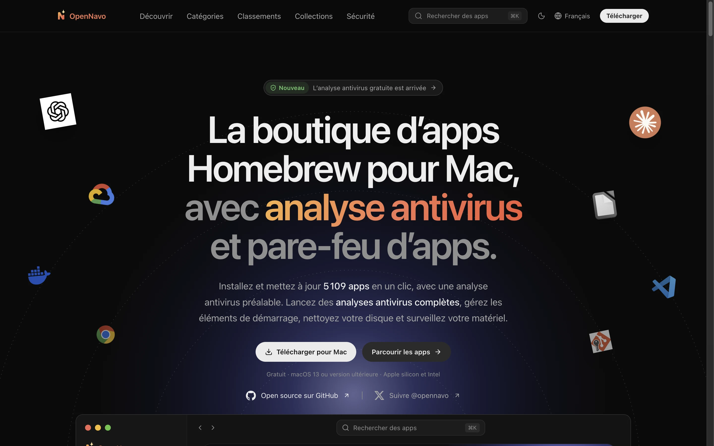
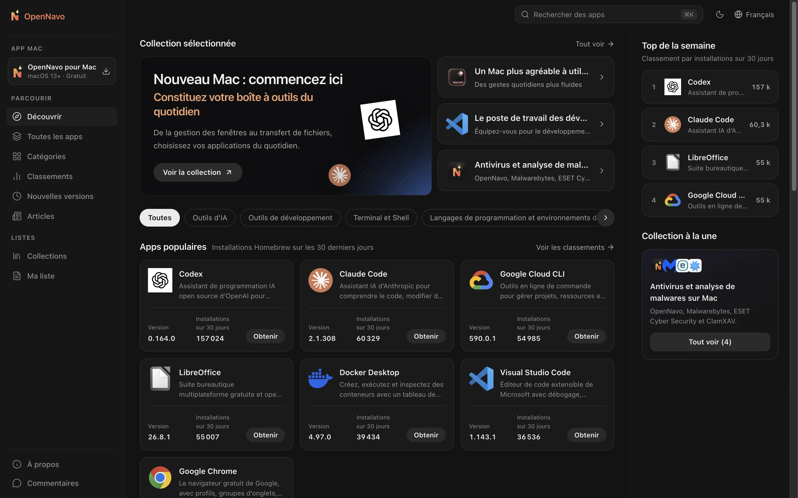
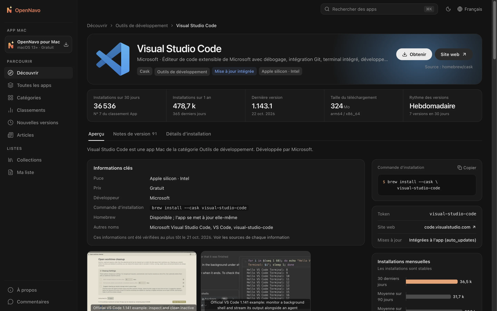
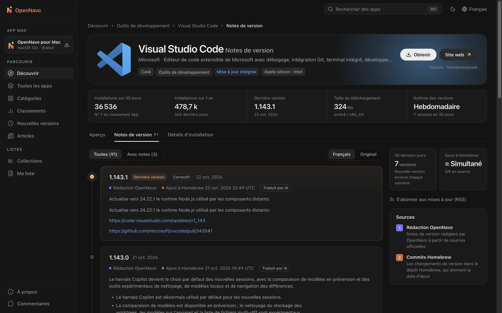

<div align="center">


# OpenNavo

[English](../../README.md) · [简体中文](README.zh-CN.md) · [日本語](README.ja-JP.md) · [Español](README.es-ES.md) · [Português (Brasil)](README.pt-BR.md) · [Русский](README.ru-RU.md) · [Deutsch](README.de-DE.md) · **Français** · [Italiano](README.it-IT.md) · [繁體中文](README.zh-Hant.md)

**La boutique d’apps Homebrew pour Mac**

Parcourez les descriptions et les notes de version de plus de 7 700 Homebrew Casks,<br>
puis installez et mettez à jour vos apps en un clic avec le client macOS. Homebrew exécute chaque étape, et vous pouvez tout suivre.

[](../../LICENSE)


[Site web](https://opennavo.com/fr) · [Parcourir les apps](https://opennavo.com/fr/discover) · [Télécharger](https://opennavo.com/fr/download) · [Contribuer](#contribuer)



</div>

## Présentation

<!-- brand-definition -->
OpenNavo est un client graphique Homebrew pour Mac, gratuit et open source, qui permet d’installer et de mettre à jour les apps Homebrew sur votre Mac en un clic ; son site web est un répertoire d’apps Mac proposant des historiques de versions, la configuration requise et des instructions de désinstallation.
<!-- /brand-definition -->

Homebrew est un moyen fiable d’installer des logiciels sur Mac, mais la ligne de commande ne convient pas à tout le monde, et `brew outdated` ne vous indique pas ce qui a changé. OpenNavo offre à Homebrew Cask une interface de boutique d’apps :

- **Web** : parcourez, recherchez et comparez les apps, consultez les notes de chaque version et copiez les commandes d’installation.
- **Client macOS** : toutes les fonctions du site, plus l’installation et les mises à jour via Homebrew sur votre propre Mac, la désinstallation complète d’apps de toute provenance, le nettoyage prudent des caches et fichiers résiduels, la surveillance du système dans la barre des menus et l’historique de chaque opération.
- **Langues** : le site prend en charge dix langues : English, 简体中文, 繁體中文, 日本語, Español, Português (Brasil), Русский, Deutsch, Français et Italiano. Le client macOS propose les mêmes dix langues ; l’administration en utilise six : English, 简体中文, 日本語, Español, Português (Brasil) et Русский. Les descriptions d’apps et les notes de version sont traduites automatiquement, et le texte original reste toujours accessible.
- **Sans compte** : aucune inscription ni connexion. Ouvrez le site et commencez à parcourir les apps.

[opennavo.com](https://opennavo.com/fr) utilise le code de ce dépôt.

## Fonctionnalités

### Web

- **Découvrir** : catégories, classements fondés sur les installations réelles, sélection éditoriale et collections.
- **Recherche** : noms anglais et chinois, pinyin et alias. Par exemple, `weixin` trouve WeChat et `vscode` trouve Visual Studio Code. Accessible partout avec <kbd>⌘</kbd> <kbd>K</kbd>.
- **Fiches d’apps** : descriptions, captures d’écran, nombre d’installations et rythme des mises à jour, dépendances et conflits, chemins d’installation et comportement de désinstallation.
- **Notes de version** : une chronologie des changements de chaque version, avec la date d’ajout à Homebrew et le choix entre traduction et texte original.
- **Brewfile** : ajoutez des apps à votre liste en parcourant le catalogue et générez un Brewfile en un clic. Les collections s’exportent aussi directement.
- **Ouvrir dans le client** : confiez l’installation au client macOS via des liens profonds `opennavo://`.

### Client macOS

- **Installer, mettre à jour et désinstaller en un clic** : les tâches s’exécutent dans une file avec progression en direct et affichage des véritables commandes brew. Consultez les journaux et réessayez en cas d’échec.
- **Désinstaller des apps de toute provenance** : les apps provenant de Homebrew, de l’App Store, d’images disque et d’installateurs .pkg sont répertoriées avec leur taille et leur dernière ouverture. Avant toute suppression, vous examinez chaque fichier associé trouvé : données, caches, préférences, éléments en arrière-plan et reçus d’installation. Les fichiers vont par défaut dans la Corbeille, ce qui permet d’annuler l’opération.
- **Nettoyer le Mac** : une analyse en lecture seule repère caches d’apps, journaux, caches des navigateurs et outils de développement, téléchargements et anciennes versions Homebrew, ainsi que les fichiers laissés par les apps déjà supprimées. Elle trouve aussi les anciens fichiers temporaires, installateurs devenus inutiles, fichiers de compilation de projets inactifs depuis un mois, Corbeille, sauvegardes d’appareils et archives Xcode, ainsi que l’espace récupérable par Docker. Les résultats sont regroupés par risque : les fichiers régénérables sont supprimés directement, les résidus et installateurs vont dans la Corbeille pour permettre l’annulation, et aucun fichier personnel n’est présélectionné. Les caches des apps en cours d’exécution sont ignorés.
- **Surveillance du système** : CPU, GPU, mémoire, disques, réseau, batterie, température et ventilateurs, avec courbes sur la dernière minute ou heure, consommation du CPU et du GPU, état des disques (SMART) et processus les plus gourmands en CPU, mémoire, disque ou réseau. Chaque indicateur peut apparaître séparément dans la barre des menus, sans limite de nombre (CPU et mémoire sont activés par défaut), sous forme de texte ou de petit graphique. Un clic affiche les détails juste en dessous. Des alertes facultatives signalent les points à surveiller. La vitesse des ventilateurs est toujours visible ; l’utilitaire nécessaire au réglage manuel s’installe en un clic dans le client ou depuis la barre des menus. Les mesures restent en mémoire sur votre Mac, sans envoi ni écriture sur disque.
- **Gestion des mises à jour** : vérifications planifiées et mise à jour de toutes les apps en un clic, avec prise en charge des apps qui se mettent à jour elles-mêmes (`auto_updates`) et des apps épinglées. Votre accord est demandé avant de mettre à jour une app ouverte.
- **Historique local** : chaque installation, mise à jour et désinstallation est enregistrée et peut être exportée.
- **Prise en main** : détection de l’environnement Homebrew et aide à son installation. Basculement en un clic entre les miroirs en Chine : Tsinghua TUNA, USTC et Alibaba Cloud.
- **Autres fonctions** : présence dans la barre des menus, import et export de Brewfile, catalogue hors ligne et mises à jour d’OpenNavo.

### Administration et gestion des contenus

- Gérez catégories, textes dans toutes les langues du site, icônes et couleurs d’accent, captures d’écran, sélections, collections, terminologie et annonces du client.
- Gérez notes de version et traductions, synchronisations, analyses de recherche, retours utilisateurs, versions du client, miroirs et configuration distante. Comprend administrateurs, rôles, autorisations et journaux d’audit. Les modifications peuvent être restaurées et les éléments supprimés passent d’abord par une corbeille.
- Service [MCP](https://modelcontextprotocol.io) intégré : les agents IA peuvent entretenir les contenus dans la limite des autorisations accordées. Toutes les écritures proposent une simulation (dry run).

## Captures d’écran

<table>
  <tr>
    <td width="50%"></td>
    <td width="50%"></td>
  </tr>
  <tr>
    <td align="center">Découvrir : catégories, apps populaires et mises à jour récentes</td>
    <td align="center">Fiche : description, chiffres clés et commandes d’installation</td>
  </tr>
  <tr>
    <td colspan="2"></td>
  </tr>
  <tr>
    <td colspan="2" align="center">Notes de version : changements et date d’ajout de chaque version à Homebrew</td>
  </tr>
</table>

## Comment le client utilise Homebrew

Le client exécute des commandes sur votre ordinateur : des limites de sécurité claires sont donc prioritaires.

- **Le serveur n’exécute jamais brew**. Installations, mises à jour et désinstallations sont lancées par le client sur votre Mac.
- **Sans shell** : brew est appelé avec un tableau d’arguments. Les noms de paquets doivent passer une validation par liste d’autorisation pour empêcher l’injection de commandes.
- **Casks uniquement** : les commandes brew visant une app incluent explicitement `--cask`. Les écritures sur les Formulae sont refusées.
- **Désinstallation prudente** : OpenNavo supprime lui-même les apps non installées par Homebrew, sans exécuter leurs désinstallateurs ni leurs scripts d’installation. Les fichiers associés sont identifiés par Bundle ID, App Group, éléments en arrière-plan, reçus d’installation et règles zap de Homebrew. Les fichiers dont seul le nom ressemble à celui de l’app, ou qui servent aussi à d’autres apps, ne sont pas présélectionnés. Chaque chemin est revérifié juste avant la suppression, sans suivre les liens symboliques. Les éléments nécessitant des droits d’administration sont traités en un lot après une seule demande de mot de passe macOS ; Homebrew peut en demander un séparément pour ses propres étapes. Les apps fournies avec macOS ne sont pas répertoriées.
- **Nettoyage prudent** : le nettoyage ne parcourt que des emplacements fixes : caches, journaux et outils de développement, dossier temporaire, Téléchargements et Bureau, projets, Corbeille, sauvegardes d’appareils et résidus reconnus par les règles de désinstallation. Images Docker, cache de compilation et conteneurs arrêtés sont supprimés uniquement par les commandes Docker ; les volumes ne sont jamais proposés. Historique, cookies, mots de passe et extensions des navigateurs restent intacts, tout comme trousseaux, gestionnaires de mots de passe, outils VPN et IA, machines virtuelles et iCloud Drive. Vous pouvez protéger d’autres contenus en les ajoutant à une liste. Chaque élément est revérifié avant suppression, sans suivre les liens symboliques, et le nettoyage ne demande jamais de droits d’administration.
- **Réglage prudent des ventilateurs** : un petit utilitaire n’accepte que cinq commandes fixes, uniquement depuis OpenNavo. Les ventilateurs ne sont jamais arrêtés : leur vitesse reste entre les limites du système. Ils repassent sous contrôle du système si OpenNavo quitte, plante ou ne répond plus pendant 15 secondes, si le Mac se met en veille ou si une écriture échoue. La chaleur n’empêche pas le réglage manuel ; si la puce reste à au moins 95 °C pendant 10 secondes, les ventilateurs en mode manuel passent à pleine vitesse.
- **Vous décidez** : toute écriture demandée par un lien profond web exige votre confirmation dans le client avant exécution.
- **Aucun hébergement d’installateurs** : les téléchargements proviennent directement des sources d’origine ou de Homebrew. OpenNavo ne fournit pas les installateurs lui-même.

## Architecture

```text
opennavo/
├── apps/
│   ├── web/                Site web (Nuxt 4 SSR)
│   ├── desktop/            Client macOS (Tauri 2 · Vue 3 · Rust)
│   ├── admin/              Administration (basée sur soybean-admin v2.2.0)
│   ├── server/             Backend Go : API publiques, d’administration et d’agents ; worker
│   └── mcp/                Service MCP (Python · FastMCP), appelle uniquement l’API Agent du backend
├── packages/
│   ├── ui/                 Composants de présentation partagés entre site et client
│   ├── tokens/             Source unique des couleurs, rayons et tailles de texte
│   ├── shared/             Langues, codes d’erreur, comparaison de versions et logique commune
│   └── api/                Types TypeScript générés à partir des contrats OpenAPI
├── tooling/
│   ├── scripts/
│   ├── config/
│   └── i18n/
├── ops/                Docker Compose, Caddy, Prometheus / Grafana, scripts de sauvegarde
├── docs/
│   ├── i18n/
│   ├── security/
│   ├── legal/
│   └── design/
└── .github/
```

Le backend synchronise le catalogue et les installations depuis les API publiques de Homebrew, lit les commits Homebrew pour dater l’ajout de chaque version, vérifie la taille des téléchargements et produit des catalogues hors ligne pour le client. Les API suivent une démarche fondée sur les contrats : modifiez d’abord `apps/server/api/*.openapi.yaml`, puis exécutez `make gen` pour générer le code Go et TypeScript.

Les Casks autres que les polices sont automatiquement désactivés lorsque le commit Homebrew de leur version complète actuelle date de plus de 90 jours. Un changement de version efface cet état local jusqu’à vérification de la date du commit. Les apps dont cette date est inconnue restent actives selon cette règle, et les exclusions explicites de récupération de l’historique sont respectées. L’état de désactivation propre à Homebrew et les apps masquées manuellement restent indépendants. La règle s’applique pendant la synchronisation du catalogue, même aux réponses inchangées. Les entrées désactivées restent accessibles via **Afficher les apps désactivées** et la liste des apps installées.

| Partie | Technologies |
| --- | --- |
| Web | Nuxt 4 · Vue 3 · UnoCSS (SSR) |
| Client macOS | Tauri 2 · Vue 3 · Rust · SQLite (FTS5) |
| Administration | soybean-admin v2.2.0 · Vue 3 · Naive UI |
| Backend | Go · Gin · GORM · PostgreSQL 18 · Redis 8 · asynq · stockage compatible S3 (MinIO) |
| MCP | Python 3.13 · FastMCP · uv |
| Contrats et génération | OpenAPI 3.0.3 · oapi-codegen · openapi-typescript · tauri-specta |

## Démarrage rapide

### Prérequis

- Node.js 24 et pnpm 10
- Go 1.27 et Rust 1.96.0 (la version exacte de Rust est fixée dans `apps/desktop/src-tauri/rust-toolchain.toml`)
- Python 3.13 et [uv](https://docs.astral.sh/uv/) (MCP)
- Docker (PostgreSQL, Redis et MinIO en local)
- macOS 13 ou ultérieur (client uniquement)

### Exécution locale

```sh
# Vérifier les outils et installer les dépendances
make setup

# Démarrer l’infrastructure locale, exécuter les migrations et charger les données initiales
make infra migrate seed

# Synchroniser le catalogue depuis l’API publique de Homebrew (accès réseau nécessaire)
node tooling/scripts/tasks/server.mjs catalog-sync

# Lancer chaque commande dans un terminal distinct
make dev-api           # API publiques et d’administration    http://localhost:8080
make dev-worker        # Worker : synchronisation, traduction, instantanés
make dev-web           # Site web                             http://localhost:3000
make dev-admin         # Administration                       http://localhost:9527
make dev-desktop       # Client macOS (Tauri)
```

Les identifiants d’administration locaux proviennent de `ADMIN_BOOTSTRAP_USERNAME` / `ADMIN_BOOTSTRAP_PASSWORD` dans `apps/server/.env.example` et servent uniquement au développement. Exécutez `make help` pour voir toutes les commandes.

Pour travailler uniquement sur le frontend, utilisez les simulations sans lancer le backend : `make mock` fournit des mocks Prism à partir des contrats OpenAPI (API publique sur le port 4010, administration sur le port 4011). Lancez ensuite `MOCK=1 make dev-web` ou `MOCK=1 make dev-admin`. `make dev-desktop-web` exécute l’interface du client dans un navigateur en remplaçant les appels système par des simulations.

### Configuration

- `apps/server/.env.example` répertorie toutes les variables d’environnement du backend et les valeurs locales par défaut. Placez les secrets locaux, comme les clés API, dans `apps/server/.env.local`, ignoré par Git et lu automatiquement au démarrage. Les variables explicites du processus priment sur `.env.local`, qui prime sur les valeurs non vides de `.env.example` pour les commandes de développement.
- La traduction des contenus est désactivée par défaut. Activez-la dans **Système → Paramètres IA de traduction** en saisissant l’URL, la clé et le modèle d’une API compatible OpenAI. Sans ces réglages, le backend utilise `LLM_BASE_URL` (par défaut `https://api.openai.com/v1`), `LLM_API_KEY` et `LLM_MODEL`.
- Si `APP_ENV` vaut `staging` ou `prod`, le backend refuse les secrets d’exemple de `.env.example` afin d’éviter un déploiement avec des valeurs publiques.

### Tests

```sh
make lint test
```

Inclut la validation OpenAPI, les contrôles statiques et les tests unitaires Go / TypeScript / Rust / Python, ainsi que la vérification des textes dans toutes les langues d’interface (dix sur le site et dans le client macOS, six dans l’administration). Les tests de bout en bout dans le navigateur sont disponibles via `make e2e`.

> [!IMPORTANT]
> Pendant le développement et les tests, n’exécutez pas réellement `brew install`, `upgrade`, `uninstall`, `cleanup` ou `update` sur votre ordinateur. Testez les écritures du client avec le faux brew en définissant `OPENNAVO_BREW_PATH` sur `apps/desktop/src-tauri/tests/fake-brew/brew`.

## Déploiement

Le déploiement de production part de `ops/docker-compose.prod.yml` : deux réplicas d’API, deux du site, un worker, Redis et Caddy. PostgreSQL (`local-db`), Prometheus / Grafana / asynqmon (`monitoring`) et les sauvegardes quotidiennes (`backup`) s’activent par profils facultatifs.

Consultez le [guide de déploiement](../../ops/GUIDE.md) pour les commandes de construction d’images, les `COMPOSE_ENV_FILES` externes, l’initialisation de la base et de S3, les sauvegardes et restaurations, les profils et les mises à niveau.

## Contribuer

Les issues et pull requests sont les bienvenues. Le processus complet figure dans [CONTRIBUTING.md](../../.github/CONTRIBUTING.md). Avant de commencer :

- **Contrats d’abord** : modifiez `apps/server/api/*.openapi.yaml` avant l’implémentation et lancez `make gen`. Ne modifiez pas les fichiers générés à la main.
- **Tokens de design** : utilisez `packages/tokens/tokens.json` pour les couleurs, rayons et autres valeurs. Ne codez pas de couleurs en dur dans les composants.
- **Base de données** : ajoutez de nouvelles migrations sans modifier les anciennes.
- **Textes** : placez tous les textes visibles dans les fichiers de langue et fournissez toutes les langues de l’interface concernée : dix pour le site et le client macOS, six pour l’administration. `make lint` vérifie leur exhaustivité.
- **Messages de commit** : suivez [Conventional Commits](https://www.conventionalcommits.org/en/), par exemple `feat(desktop): …` ou `fix(server): …`.
- Vérifiez que `make lint test` réussit avant de créer un commit.

## Sécurité

Signalez les vulnérabilités en privé à **admin@opennavo.com**. Consultez [SECURITY.md](../../.github/SECURITY.md) pour les versions prises en charge et le canal privé facultatif de GitHub. N’ouvrez pas d’issue publique concernant une vulnérabilité.

## Licence

Ce projet est open source sous la [Licence publique générale GNU, version 3 uniquement (GPL-3.0-only)](../../LICENSE). Les versions publiées au commit `5fa4056` et avant restent disponibles sous Apache-2.0. Les avis tiers et les conditions supplémentaires ci-dessous figurent dans [NOTICE](../../NOTICE) ; les justificatifs des dépendances et les instructions de distribution sont dans [THIRD_PARTY.md](../legal/THIRD_PARTY.md).

Selon les conditions supplémentaires de NOTICE fondées sur l’article 7(e) de la GPLv3, aucun droit de marque sur le nom ou le logo OpenNavo n’est accordé. Selon l’article 7(c), les versions modifiées distribuées doivent se distinguer clairement de l’original : utilisez un autre nom et une autre icône, et remplacez le Bundle ID, la clé publique de mise à jour et l’URL de mise à jour du client. Préservez une attribution exacte. Homebrew est une marque du projet Homebrew ; OpenNavo n’y est pas affilié. Les noms et icônes des apps appartiennent à leurs propriétaires respectifs.
