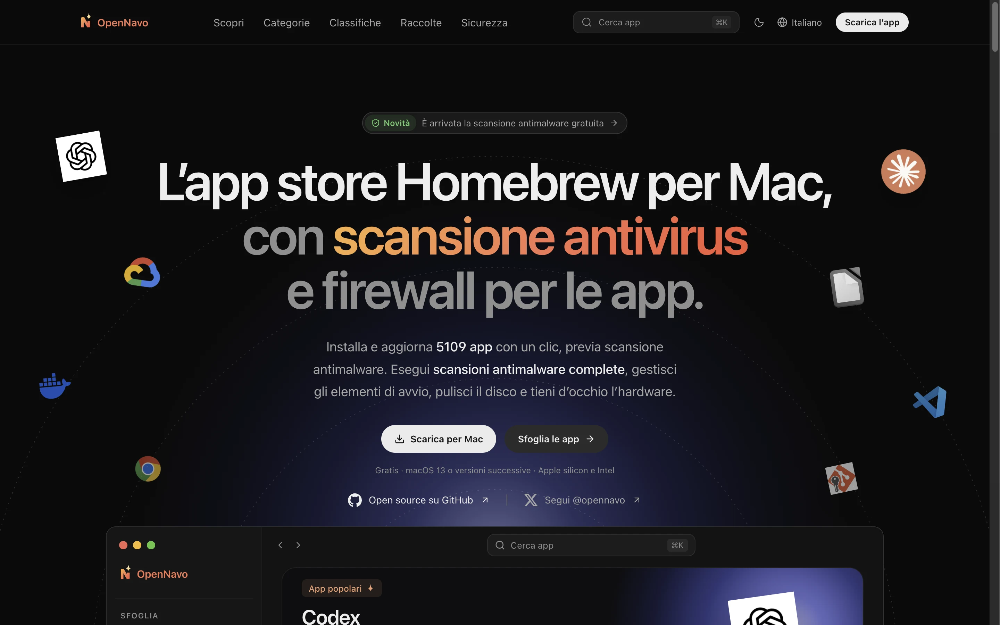
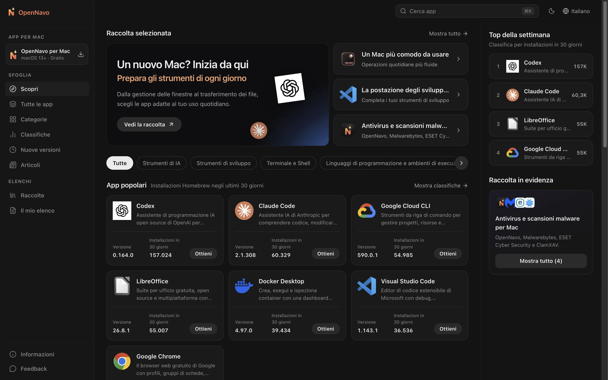
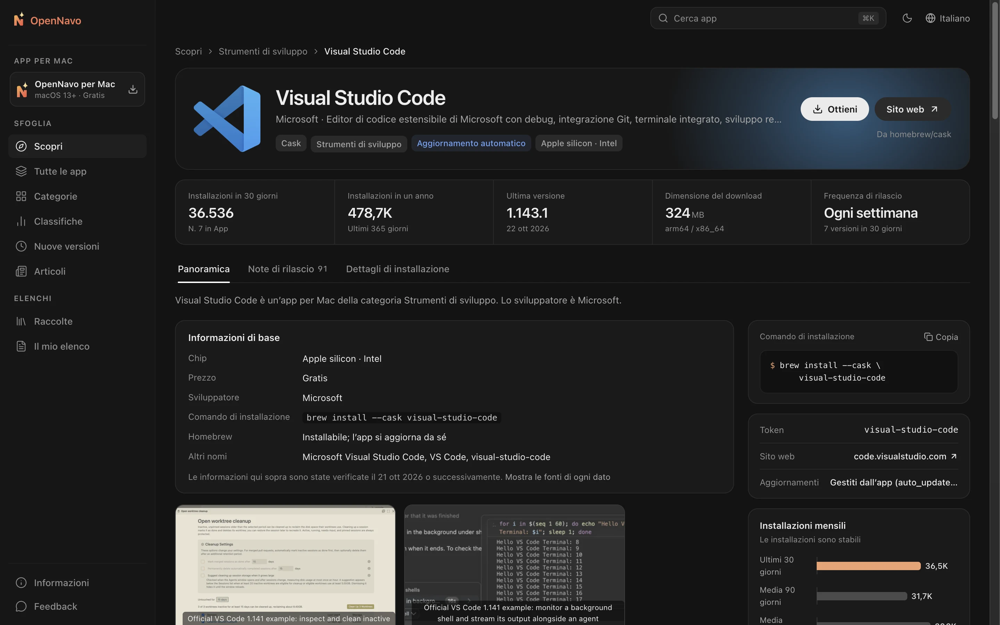
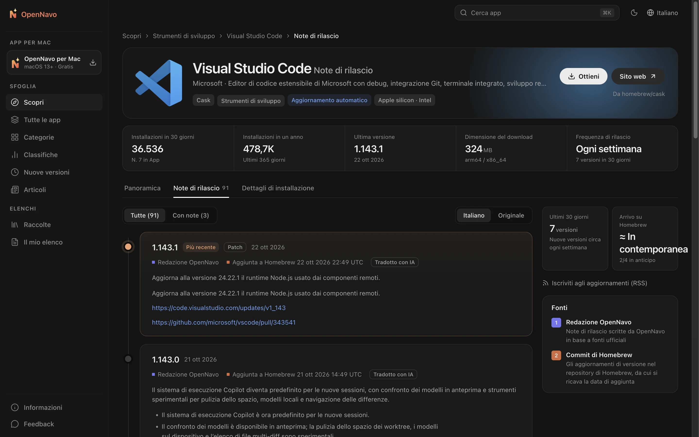

<div align="center">


# OpenNavo

[English](../../README.md) · [简体中文](README.zh-CN.md) · [日本語](README.ja-JP.md) · [Español](README.es-ES.md) · [Português (Brasil)](README.pt-BR.md) · [Русский](README.ru-RU.md) · [Deutsch](README.de-DE.md) · [Français](README.fr-FR.md) · **Italiano** · [繁體中文](README.zh-Hant.md)

**L’app store Homebrew per Mac**

Esplora descrizioni e note di versione di oltre 7.700 Homebrew Cask,<br>
poi installa e aggiorna le app con un clic dal client macOS. Homebrew esegue ogni passaggio e puoi seguirlo in tempo reale.

[](../../LICENSE)


[Sito web](https://opennavo.com/it) · [Esplora le app](https://opennavo.com/it/discover) · [Scarica](https://opennavo.com/it/download) · [Contribuisci](#contribuisci)



</div>

## Introduzione

<!-- brand-definition -->
OpenNavo è un client grafico Homebrew per Mac, gratuito e open source, che installa e aggiorna le app Homebrew sul tuo Mac con un clic, mentre il suo sito web è un catalogo di app per Mac con cronologia delle versioni, requisiti di sistema e istruzioni di disinstallazione.
<!-- /brand-definition -->

Homebrew è un modo affidabile per installare software su Mac, ma la riga di comando non è adatta a tutti e `brew outdated` non spiega cosa è cambiato. OpenNavo offre a Homebrew Cask un’interfaccia da app store:

- **Web**: sfoglia, cerca e confronta app, leggi le note di ogni versione e copia i comandi di installazione.
- **Client macOS**: tutte le funzioni del sito, più installazione e aggiornamenti tramite Homebrew sul tuo Mac, disinstallazione completa di app da qualsiasi fonte, pulizia attenta di cache e residui, monitoraggio del sistema nella barra dei menu e cronologia di ogni operazione.
- **Lingue**: il sito supporta dieci lingue: English, 简体中文, 繁體中文, 日本語, Español, Português (Brasil), Русский, Deutsch, Français e Italiano. Il client macOS usa le stesse dieci; il pannello di amministrazione ne usa sei: English, 简体中文, 日本語, Español, Português (Brasil) e Русский. Descrizioni e note di versione sono tradotte automaticamente, con il testo originale sempre disponibile.
- **Nessun account richiesto**: non servono registrazione o accesso. Apri il sito e inizia a esplorare.

[opennavo.com](https://opennavo.com/it) esegue il codice di questo repository.

## Funzionalità

### Web

- **Esplora**: categorie, classifiche basate sulle installazioni reali, selezioni editoriali e raccolte.
- **Ricerca**: nomi inglesi e cinesi, pinyin e alias. Per esempio, `weixin` trova WeChat e `vscode` trova Visual Studio Code. Richiamala ovunque con <kbd>⌘</kbd> <kbd>K</kbd>.
- **Dettagli delle app**: descrizioni, schermate, numero di installazioni e frequenza degli aggiornamenti, dipendenze e conflitti, percorsi di installazione e comportamento della disinstallazione.
- **Note di versione**: una cronologia delle modifiche di ogni versione, con la data di aggiunta a Homebrew e la possibilità di passare dalla traduzione all’originale.
- **Brewfile**: aggiungi app alla lista durante la navigazione e genera un Brewfile con un clic. Puoi anche esportare direttamente le raccolte.
- **Apri nel client**: affida l’installazione al client macOS tramite deep link `opennavo://`.

### Client macOS

- **Installa, aggiorna e disinstalla con un clic**: le attività vengono eseguite in coda, con avanzamento in tempo reale e comandi brew effettivi. In caso di errore puoi consultare i log e riprovare.
- **Disinstalla app da qualsiasi fonte**: le app di Homebrew, App Store, immagini disco e installatori .pkg sono elencate con dimensioni e ultima apertura. Prima di rimuovere qualcosa, controlli ogni file associato trovato, come dati, cache, preferenze, elementi in background e ricevute di installazione. I file vengono spostati nel Cestino per impostazione predefinita, così puoi annullare l’operazione.
- **Pulisci il Mac**: una scansione in sola lettura trova cache delle app, log, cache di browser e strumenti di sviluppo, download e vecchie versioni Homebrew, oltre ai residui delle app già eliminate. Individua anche vecchi file temporanei, installatori inutili, file di compilazione di progetti inattivi da un mese, Cestino, backup dei dispositivi e archivi Xcode, oltre allo spazio recuperabile da Docker. I risultati sono raggruppati per rischio: i file rigenerabili vengono eliminati subito, residui e installatori vanno nel Cestino per consentire l’annullamento e nessun file personale è preselezionato. Le cache delle app in esecuzione vengono ignorate.
- **Monitoraggio del sistema**: CPU, GPU, memoria, dischi, rete, batteria, temperatura e ventole a colpo d’occhio, con grafici dell’ultimo minuto o dell’ultima ora, potenza di CPU e GPU, stato dei dischi (SMART) e processi che usano più CPU, memoria, disco o rete. Ogni metrica può avere una propria voce nella barra dei menu, senza limiti di numero (CPU e memoria sono attive per impostazione predefinita), come testo o piccolo grafico. Un clic ne mostra i dettagli subito sotto. Gli avvisi facoltativi segnalano ciò che richiede attenzione. La velocità delle ventole è sempre visibile; l’helper per il controllo manuale si installa con un clic nel client o dalla barra dei menu. Le letture restano nella memoria del Mac e non vengono caricate online né scritte su disco.
- **Gestione degli aggiornamenti**: controlli pianificati e aggiornamento di tutte le app con un clic, con supporto per le app che si aggiornano da sole (`auto_updates`) e quelle bloccate a una versione. Prima di aggiornare un’app in esecuzione viene chiesto il tuo consenso.
- **Attività locali**: ogni installazione, aggiornamento e disinstallazione viene registrato e può essere esportato.
- **Avvio semplice**: rileva l’ambiente Homebrew e ricevi assistenza per installarlo. Passa con un clic tra i mirror in Cina: Tsinghua TUNA, USTC e Alibaba Cloud.
- **Altro**: presenza nella barra dei menu, importazione ed esportazione di Brewfile, catalogo offline e aggiornamenti di OpenNavo.

### Amministrazione e gestione dei contenuti

- Gestisci categorie, testi in tutte le lingue del sito, icone e colori principali, schermate, selezioni editoriali, raccolte, terminologia e annunci del client.
- Gestisci note di versione e traduzioni, sincronizzazioni, analisi delle ricerche, feedback, versioni del client, mirror e configurazione remota. Include amministratori, ruoli, permessi e log di controllo. Le modifiche possono essere ripristinate; gli elementi eliminati passano prima dal cestino.
- Servizio [MCP](https://modelcontextprotocol.io) integrato: gli agenti IA possono mantenere i contenuti delle app entro i permessi concessi. Tutte le operazioni di scrittura supportano simulazioni (dry run).

## Schermate

<table>
  <tr>
    <td width="50%"></td>
    <td width="50%"></td>
  </tr>
  <tr>
    <td align="center">Esplora: categorie, app popolari e aggiornamenti recenti</td>
    <td align="center">Dettagli: descrizioni, dati principali e comandi di installazione</td>
  </tr>
  <tr>
    <td colspan="2"></td>
  </tr>
  <tr>
    <td colspan="2" align="center">Note di versione: modifiche di ogni versione e data di aggiunta a Homebrew</td>
  </tr>
</table>

## Come il client usa Homebrew

Il client esegue comandi sul tuo computer, quindi i confini di sicurezza hanno la precedenza:

- **Il server non esegue mai brew**. Installazioni, aggiornamenti e disinstallazioni vengono avviati dal client sul tuo Mac.
- **Senza shell**: brew viene chiamato con un array di argomenti. I nomi dei pacchetti devono superare una verifica tramite lista consentita per impedire l’iniezione di comandi.
- **Solo Cask**: i comandi brew rivolti a un’app includono esplicitamente `--cask`. Le operazioni di scrittura sulle Formulae vengono rifiutate.
- **Disinstallazione prudente**: OpenNavo rimuove direttamente le app non installate con Homebrew, senza eseguire i loro programmi di disinstallazione o script di installazione. I file associati sono identificati tramite Bundle ID, App Group, elementi in background, ricevute di installazione e regole zap di Homebrew. I file con nomi soltanto simili, o usati anche da altre app, non sono preselezionati. Ogni percorso viene ricontrollato subito prima della rimozione e i link simbolici non vengono seguiti. Gli elementi che richiedono privilegi amministrativi sono rimossi in un unico gruppo dopo una sola richiesta della password macOS; Homebrew può richiederla separatamente per i propri passaggi. Le app integrate in macOS non vengono elencate.
- **Pulizia prudente**: la pulizia esamina solo posizioni definite: cache, log e strumenti di sviluppo, cartella temporanea, Download e Scrivania, progetti, Cestino, backup dei dispositivi e residui riconosciuti dalle regole di disinstallazione. Immagini Docker, cache di compilazione e container arrestati vengono rimossi solo tramite i comandi Docker; i volumi non vengono mai proposti. Cronologia, cookie, password ed estensioni dei browser restano intatti, così come portachiavi, gestori di password, strumenti VPN e IA, macchine virtuali e iCloud Drive. Puoi proteggere altri contenuti aggiungendoli a una lista. Ogni elemento viene ricontrollato prima della rimozione, i link simbolici non vengono seguiti e la pulizia non richiede mai privilegi amministrativi.
- **Controllo prudente delle ventole**: un piccolo helper accetta solo cinque comandi fissi ed esclusivamente da OpenNavo. Le ventole non vengono mai spente: la velocità resta tra il minimo e il massimo di sistema. Tornano sotto il controllo del sistema se OpenNavo si chiude, si arresta o non risponde per 15 secondi, quando il Mac entra in stop o se una scrittura fallisce. Il calore non blocca il controllo manuale; se il chip resta ad almeno 95 °C per 10 secondi, le ventole in modalità manuale passano alla massima velocità.
- **Decidi tu**: qualsiasi scrittura richiesta da un deep link web deve essere confermata nel client prima dell’esecuzione.
- **Nessun hosting degli installatori**: i download provengono direttamente dalle fonti originali o da Homebrew. OpenNavo non ospita gli installatori.

## Architettura

```text
opennavo/
├── apps/
│   ├── web/                Sito web (Nuxt 4 SSR)
│   ├── desktop/            Client macOS (Tauri 2 · Vue 3 · Rust)
│   ├── admin/              Amministrazione (basata su soybean-admin v2.2.0)
│   ├── server/             Backend Go: API pubbliche, amministrative e Agent; worker
│   └── mcp/                Servizio MCP (Python · FastMCP), chiama solo l’API Agent del backend
├── packages/
│   ├── ui/                 Componenti di presentazione condivisi tra sito e client
│   ├── tokens/             Fonte unica per colori, raggi e dimensioni del testo
│   ├── shared/             Lingue, codici di errore, confronto versioni e logica condivisa
│   └── api/                Tipi TypeScript generati dai contratti OpenAPI
├── tooling/
│   ├── scripts/
│   ├── config/
│   └── i18n/
├── ops/                Docker Compose, Caddy, Prometheus / Grafana, script di backup
├── docs/
│   ├── i18n/
│   ├── security/
│   ├── legal/
│   └── design/
└── .github/
```

Il backend sincronizza catalogo e installazioni dalle API pubbliche di Homebrew, legge i commit Homebrew per ricavare la data di aggiunta di ogni versione, verifica le dimensioni dei download e genera cataloghi offline per il client. Le API seguono un flusso basato sui contratti: modifica prima `apps/server/api/*.openapi.yaml`, poi esegui `make gen` per generare il codice Go e TypeScript.

I Cask che non sono font vengono disabilitati automaticamente quando il commit Homebrew della loro versione completa corrente risale a oltre 90 giorni prima. Un cambio di versione rimuove questo stato locale finché non viene verificata la data del commit. Le app con data sconosciuta restano attive secondo questa regola, che rispetta le esclusioni esplicite dal recupero della cronologia. La disabilitazione di Homebrew e le app nascoste manualmente restano indipendenti. La regola viene applicata durante la sincronizzazione del catalogo, anche alle risposte invariate. Le voci disabilitate restano accessibili con **Mostra app disabilitate** e nell’elenco delle app installate.

| Parte | Tecnologia |
| --- | --- |
| Web | Nuxt 4 · Vue 3 · UnoCSS (SSR) |
| Client macOS | Tauri 2 · Vue 3 · Rust · SQLite (FTS5) |
| Amministrazione | soybean-admin v2.2.0 · Vue 3 · Naive UI |
| Backend | Go · Gin · GORM · PostgreSQL 18 · Redis 8 · asynq · archiviazione compatibile S3 (MinIO) |
| MCP | Python 3.13 · FastMCP · uv |
| Contratti e generazione | OpenAPI 3.0.3 · oapi-codegen · openapi-typescript · tauri-specta |

## Avvio rapido

### Requisiti

- Node.js 24 e pnpm 10
- Go 1.27 e Rust 1.96.0 (la versione esatta di Rust è fissata in `apps/desktop/src-tauri/rust-toolchain.toml`)
- Python 3.13 e [uv](https://docs.astral.sh/uv/) (MCP)
- Docker (PostgreSQL, Redis e MinIO locali)
- macOS 13 o successivo (solo per il client)

### Esecuzione locale

```sh
# Verifica gli strumenti e installa le dipendenze
make setup

# Avvia l’infrastruttura locale, esegui le migrazioni e carica i dati iniziali
make infra migrate seed

# Sincronizza il catalogo dall’API pubblica Homebrew (richiede accesso alla rete)
node tooling/scripts/tasks/server.mjs catalog-sync

# Avvia ogni comando in un terminale separato
make dev-api           # API pubbliche e amministrative    http://localhost:8080
make dev-worker        # Worker: sincronizzazione, traduzione, snapshot
make dev-web           # Sito web                          http://localhost:3000
make dev-admin         # Amministrazione                   http://localhost:9527
make dev-desktop       # Client macOS (Tauri)
```

Le credenziali amministrative locali provengono da `ADMIN_BOOTSTRAP_USERNAME` / `ADMIN_BOOTSTRAP_PASSWORD` in `apps/server/.env.example` e servono solo per lo sviluppo. Esegui `make help` per vedere tutti i comandi.

Per lavorare solo sul frontend puoi usare simulazioni senza avviare il backend: `make mock` offre mock Prism basati sui contratti OpenAPI (API pubblica sulla porta 4010, amministrativa sulla 4011). Avvia il frontend con `MOCK=1 make dev-web` o `MOCK=1 make dev-admin`. `make dev-desktop-web` esegue l’interfaccia del client nel browser sostituendo le chiamate di sistema con simulazioni.

### Configurazione

- `apps/server/.env.example` elenca tutte le variabili d’ambiente del backend e i valori locali predefiniti. Inserisci i segreti locali, come le chiavi API, in `apps/server/.env.local`, ignorato da Git e letto automaticamente all’avvio. Le variabili esplicite del processo hanno priorità su `.env.local`, che prevale sui valori non vuoti di `.env.example` nei comandi di sviluppo.
- La traduzione dei contenuti è disattivata per impostazione predefinita. Attivala in **Sistema → Impostazioni IA di traduzione** nel pannello, inserendo URL, chiave e modello di un’API compatibile con OpenAI. In assenza di queste impostazioni il backend usa `LLM_BASE_URL` (predefinito: `https://api.openai.com/v1`), `LLM_API_KEY` e `LLM_MODEL`.
- Quando `APP_ENV` è `staging` o `prod`, il backend rifiuta i segreti di esempio di `.env.example` per evitare distribuzioni con valori pubblici.

### Test

```sh
make lint test
```

Include convalida OpenAPI, controlli statici e test unitari per Go / TypeScript / Rust / Python, oltre ai controlli di completezza di tutte le lingue dell’interfaccia (dieci sul sito e nel client macOS, sei nel pannello). I test end-to-end nel browser sono disponibili tramite `make e2e`.

> [!IMPORTANT]
> Durante sviluppo e test non eseguire realmente `brew install`, `upgrade`, `uninstall`, `cleanup` o `update` sul tuo computer. Per verificare le scritture del client usa il brew simulato, impostando `OPENNAVO_BREW_PATH` su `apps/desktop/src-tauri/tests/fake-brew/brew`.

## Distribuzione

La distribuzione in produzione parte da `ops/docker-compose.prod.yml`: due repliche API, due del sito, un worker, Redis e Caddy. PostgreSQL (`local-db`), Prometheus / Grafana / asynqmon (`monitoring`) e backup giornalieri (`backup`) si attivano tramite profili facoltativi.

Segui la [guida alla distribuzione](../../ops/GUIDE.md) per i comandi di build delle immagini, i `COMPOSE_ENV_FILES` esterni, l’inizializzazione di database e S3, backup e ripristino, profili e aggiornamenti.

## Contribuisci

Issue e pull request sono benvenute. Consulta [CONTRIBUTING.md](../../.github/CONTRIBUTING.md) per il flusso completo. Prima di iniziare:

- **Prima i contratti**: modifica `apps/server/api/*.openapi.yaml` prima dell’implementazione ed esegui `make gen`. Non modificare a mano i file generati.
- **Token di design**: usa `packages/tokens/tokens.json` per colori, raggi e altri valori. Non inserire colori fissi nei componenti.
- **Database**: aggiungi nuove migrazioni senza modificare quelle esistenti.
- **Testi**: inserisci tutti i testi visibili nei file di lingua e fornisci tutte le lingue dell’interfaccia interessata: dieci per sito e client macOS, sei per il pannello. `make lint` ne controlla la completezza.
- **Messaggi di commit**: segui [Conventional Commits](https://www.conventionalcommits.org/en/), ad esempio `feat(desktop): …` o `fix(server): …`.
- Assicurati che `make lint test` passi prima di creare un commit.

## Sicurezza

Segnala le vulnerabilità in privato a **admin@opennavo.com**. Consulta [SECURITY.md](../../.github/SECURITY.md) per le versioni supportate e il canale privato facoltativo di GitHub. Non aprire issue pubbliche per le vulnerabilità.

## Licenza

Questo progetto è open source con [GNU General Public License, solo versione 3 (GPL-3.0-only)](../../LICENSE). Le versioni pubblicate al commit `5fa4056` e precedenti restano disponibili con Apache-2.0. Le note sui componenti di terze parti e le condizioni aggiuntive seguenti sono in [NOTICE](../../NOTICE); le prove relative alle dipendenze e le istruzioni di distribuzione sono in [THIRD_PARTY.md](../legal/THIRD_PARTY.md).

Le condizioni aggiuntive di NOTICE ai sensi della sezione 7(e) della GPLv3 non concedono diritti sui marchi relativi al nome o al logo OpenNavo. Ai sensi della sezione 7(c), le versioni modificate distribuite devono distinguersi chiaramente dall’originale: usa nome e icona diversi e sostituisci Bundle ID, chiave pubblica e URL degli aggiornamenti del client. Mantieni un’attribuzione accurata. Homebrew è un marchio del progetto Homebrew; OpenNavo non è affiliato a Homebrew. Nomi e icone delle app appartengono ai rispettivi proprietari.
