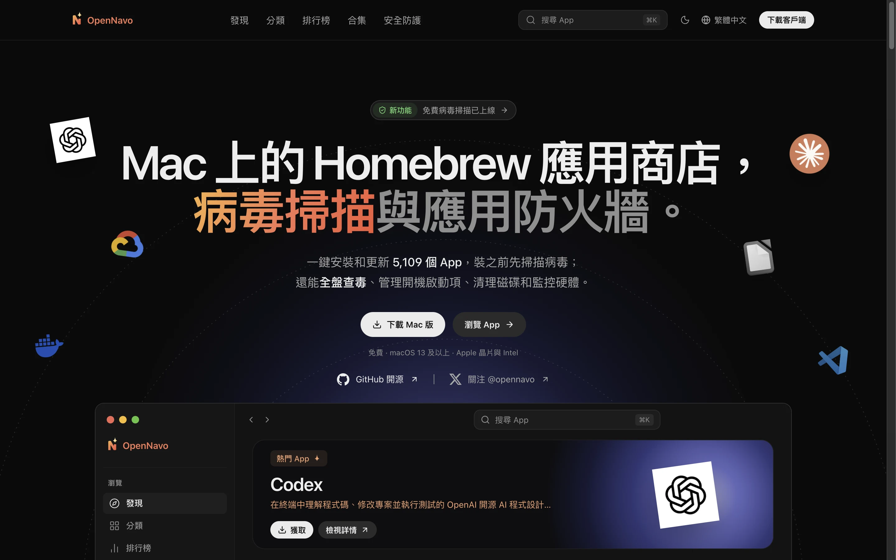
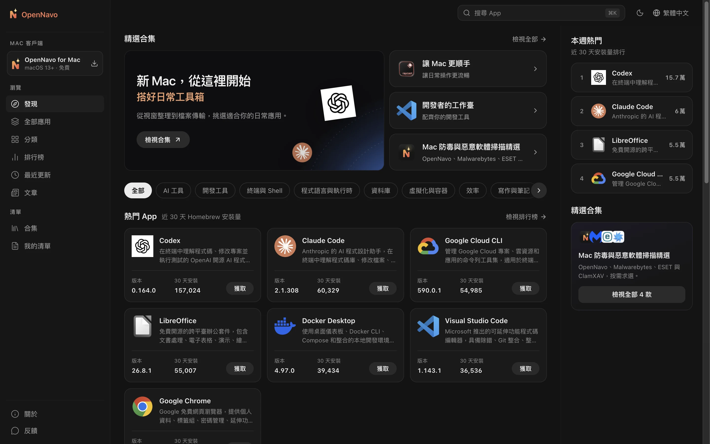
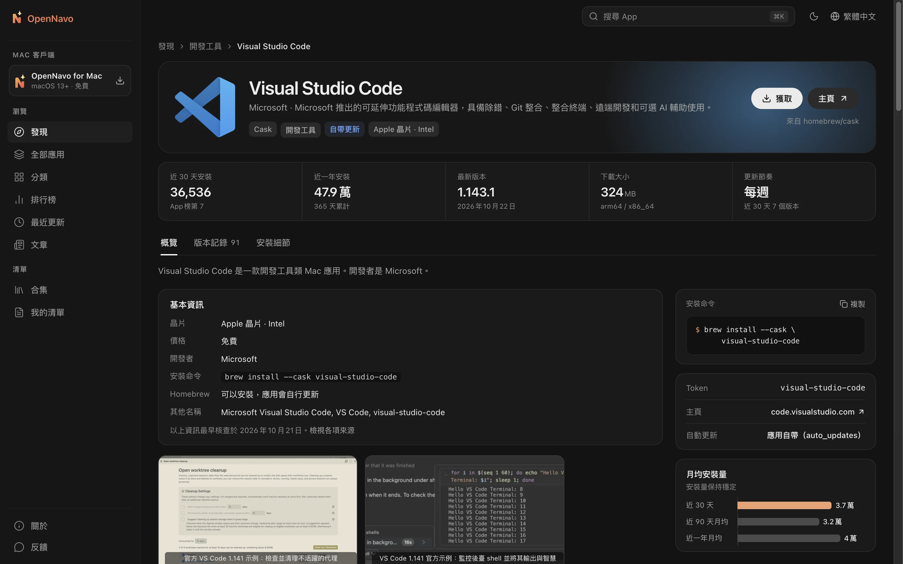
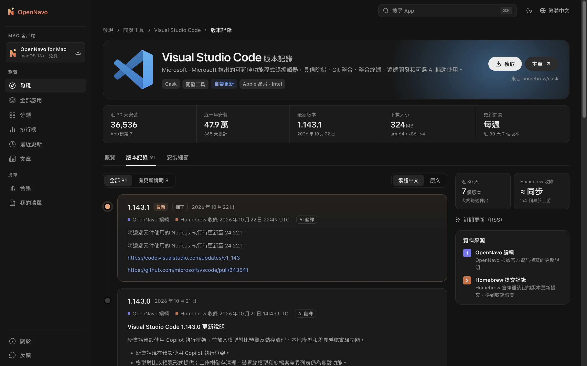

<div align="center">


# OpenNavo

[English](../../README.md) · [简体中文](README.zh-CN.md) · [日本語](README.ja-JP.md) · [Español](README.es-ES.md) · [Português (Brasil)](README.pt-BR.md) · [Русский](README.ru-RU.md) · [Deutsch](README.de-DE.md) · [Français](README.fr-FR.md) · [Italiano](README.it-IT.md) · **繁體中文**

**Mac 上的 Homebrew 應用商店**

瀏覽 7,700 多個 Homebrew Cask 的介紹與版本記錄，<br>
用 macOS 客戶端一鍵安裝、一鍵更新——每一步都交給 Homebrew，每一步都看得見。

[](../../LICENSE)


[官網](https://opennavo.com/zh-hant) · [瀏覽 App](https://opennavo.com/zh-hant/discover) · [下載客戶端](https://opennavo.com/zh-hant/download) · [參與貢獻](#參與貢獻)



</div>

## 簡介

<!-- brand-definition -->
OpenNavo 是一款免費、開源的 Mac 版 Homebrew 圖形客戶端：在你的 Mac 上一鍵安裝和更新 Homebrew 應用；它的網站是一個 Mac App 目錄，提供版本記錄、系統要求和解除安裝方法等資訊。
<!-- /brand-definition -->

Homebrew 是 Mac 上裝軟體最可靠的方式，但命令列不適合每個人，`brew outdated` 也不會告訴你更新了什麼。OpenNavo 給 Homebrew Cask 配上一個應用商店：

- **網頁端**：任何人都能瀏覽、搜尋、比較 App，檢視每個版本的更新說明，複製安裝命令。
- **macOS 客戶端**：在網頁端的全部能力之上，呼叫你電腦上的 Homebrew 完成安裝與更新，徹底解除安裝任何來源的 App，謹慎清理快取和殘留，在選單列監控電腦狀態，並記錄每一次操作。
- **多種語言**：網站支援十種語言：English、簡體中文、繁體中文、日本語、Español、Português (Brasil)、Русский、Deutsch、Français、Italiano；macOS 客戶端同樣支援這十種，管理後台使用其中六種：English、簡體中文、日本語、Español、Português (Brasil)、Русский。App 介紹與更新說明自動翻譯，隨時可以切回原文。
- **無需帳號**：不用註冊，也不用登入，開啟就能用。

[opennavo.com](https://opennavo.com/zh-hant) 執行的就是這個倉庫的程式碼。

## 功能

### 網頁端

- **發現**：分類、按真實安裝量排序的榜單、編輯精選與合集。
- **搜尋**：支援英文名、中文名、拼音與別名，例如 `weixin` 能搜到微信，`vscode` 能搜到 Visual Studio Code；按 <kbd>⌘</kbd> <kbd>K</kbd> 隨時喚起。
- **App 詳情**：介紹、截圖、安裝量與更新節奏、依賴與衝突、安裝位置與解除安裝行為。
- **版本記錄**：按時間線展示每個版本的更新說明，標註 Homebrew 收錄時間，可在譯文與原文之間切換。
- **Brewfile**：瀏覽時把 App 加入清單，一鍵生成 Brewfile；合集也能直接匯出。
- **在客戶端中開啟**：透過 `opennavo://` 深鏈把安裝交給 macOS 客戶端。

### macOS 客戶端

- **一鍵安裝、更新、解除安裝**：任務排隊執行，即時顯示進度和實際執行的 brew 命令；失敗時可以檢視日誌並重試。
- **解除安裝任何來源的 App**：Homebrew、App Store、拖拽安裝和 .pkg 安裝的 App 都會列出來，附帶大小和最近使用時間。刪除前，找到的每一個相關檔案（應用資料、快取、偏好設定、背景項目、安裝回執等）都會先列給你確認；預設移到垃圾桶，可以撤銷。
- **清理電腦**：只讀掃描，找出應用快取、日誌、瀏覽器和開發工具快取、Homebrew 的下載快取和舊版本，以及已刪除 App 留下的殘留；還會找出舊的臨時檔案、用不上的安裝包、一個月沒動的專案的建置產物、垃圾桶、裝置備份和 Xcode 歸檔，以及 Docker 可回收的空間。結果按風險分檔：可再生的檔案直接刪除，殘留和安裝包移到垃圾桶、可以撤銷，個人檔案不會替你勾選。正在執行的 App 的快取會跳過。
- **電腦監控**：一頁看清 CPU、GPU、記憶體、磁碟、網路、電池、溫度和風扇，附帶最近一分鐘或一小時的曲線、CPU 和 GPU 功耗、磁碟健康（SMART），以及佔用 CPU、記憶體、磁碟、網路最多的程序。每個指標都可以單獨放到選單列，數量不限（預設開啟 CPU 和記憶體），可以顯示文字或小圖表，點哪一項就在它下面彈出詳情。可以開啟提醒，出現需要注意的問題時發通知。風扇轉速隨時可看；手動調轉速需要的輔助程式，在客戶端裡或選單列上點一下就能安裝。讀數只留在你 Mac 的記憶體裡，不上傳，也不寫入磁碟。
- **更新管理**：定時檢查可用更新、一鍵全部更新，能識別自帶更新（`auto_updates`）與已固定（pinned）的 App；正在執行的 App 會先徵求你的同意。
- **本機更新記錄**：每一次安裝、更新、解除安裝都會記錄下來，並可匯出。
- **開箱即用**：檢測 Homebrew 環境並引導安裝；一鍵切換中國鏡像站（清華 TUNA、中科大、阿里雲）。
- **更多**：選單列常駐、Brewfile 匯入匯出、離線目錄、客戶端自身更新。

### 管理後台與內容維護

- 維護分類、網站各語言文案、圖示與主色、截圖、精選、合集、術語表與客戶端公告。
- 管理版本說明與翻譯、同步任務、搜尋洞察、使用者反饋、客戶端版本釋出、鏡像站與遠端設定；提供管理員、角色權限與審計日誌，修改可恢復，刪除先進回收站。
- 內建 [MCP](https://modelcontextprotocol.io) 服務：AI Agent 可以在授予的權限範圍內維護 App 內容，所有寫操作都支援演練（dry run）。

## 截圖

<table>
  <tr>
    <td width="50%"></td>
    <td width="50%"></td>
  </tr>
  <tr>
    <td align="center">發現：分類、熱門 App 與最近更新</td>
    <td align="center">詳情：介紹、關鍵資料與安裝命令</td>
  </tr>
  <tr>
    <td colspan="2"></td>
  </tr>
  <tr>
    <td colspan="2" align="center">版本記錄：每個版本的更新說明與 Homebrew 收錄時間</td>
  </tr>
</table>

## 客戶端如何呼叫 Homebrew

客戶端會在你的電腦上執行命令，所以安全邊界是設計的第一原則：

- **服務端永遠不執行 brew**。安裝、更新、解除安裝只在你的 Mac 上由客戶端發起。
- **不經過 shell**：brew 以引數陣列呼叫，包名必須透過白名單校驗，杜絕命令注入。
- **只管 Cask**：指向具體 App 的 brew 命令都顯式帶 `--cask`；Formula 的寫操作一律拒絕。
- **謹慎解除安裝**：不是用 Homebrew 安裝的 App 由 OpenNavo 自己刪除，不會執行它們的解除安裝程式或安裝指令碼。相關檔案按 Bundle ID、App Group、背景項目、安裝回執和 Homebrew 的 zap 規則匹配；只是名字相似、或者其他 App 也在用的檔案預設不勾選。每個路徑在刪除前都會再核對一次，不跟隨符號連結。需要管理員權限的專案合成一批，只請求一次 macOS 密碼；Homebrew 自己的解除安裝步驟可能另外請求。系統自帶的 App 不會列出來。
- **謹慎清理**：清理只看固定的位置：快取、日誌和開發工具目錄，臨時資料夾，下載和桌面，專案資料夾，垃圾桶和裝置備份，以及按解除安裝規則匹配到的殘留。Docker 的映像檔、建置快取和已停止的容器只透過 Docker 自己的命令刪除，資料卷從不提供清理。瀏覽器的歷史記錄、Cookie、密碼和延伸功能不會碰，鑰匙圈、密碼管理器、VPN 和 AI 工具、虛擬機器、iCloud 雲盤也不會碰；其他內容可以加入保護名單。每一項在刪除前都會再核對一次，不跟隨符號連結，清理不會請求管理員權限。
- **謹慎控制風扇**：手動轉速經由一個很小的輔助程式執行，它只接受來自 OpenNavo 的五個固定命令。不提供關閉風扇，轉速始終在系統最小值和最大值之間。OpenNavo 退出、崩潰或 15 秒沒有回應、Mac 睡眠、寫入失敗時，風扇都會交還系統控制。溫度高時也能切到手動；晶片溫度持續 10 秒達到 95 °C 時，手動風扇會拉到全速。
- **你說了算**：網頁深鏈發起的任何寫操作，都要你在客戶端裡確認後才會執行。
- **不託管安裝包**：下載始終來自上游或 Homebrew 的源，OpenNavo 不經手安裝包本身。

## 架構

```text
opennavo/
├── apps/
│   ├── web/                網頁端（Nuxt 4 SSR）
│   ├── desktop/            macOS 客戶端（Tauri 2 · Vue 3 · Rust）
│   ├── admin/              管理後台（基於 soybean-admin v2.2.0）
│   ├── server/             Go 後端：公共 API、後台 API、Agent API、任務程序
│   └── mcp/                MCP 服務（Python · FastMCP），只呼叫後端的 Agent API
├── packages/
│   ├── ui/                 網頁端與客戶端共用的展示元件
│   ├── tokens/             設計令牌：顏色、圓角、字號的唯一來源
│   ├── shared/             語言清單、錯誤碼、版本比較等共享邏輯
│   └── api/                由 OpenAPI 契約生成的 TypeScript 型別
├── tooling/
│   ├── scripts/
│   ├── config/
│   └── i18n/
├── ops/                Docker Compose、Caddy、Prometheus / Grafana、備份指令碼
├── docs/
│   ├── i18n/
│   ├── security/
│   ├── legal/
│   └── design/
└── .github/
```

後端從 Homebrew 公開 API 同步目錄與安裝量，讀取 Homebrew 的提交記錄得到每個版本的收錄時間，並探測下載大小；為客戶端生成離線目錄快照。介面採用契約優先：先改 `apps/server/api/*.openapi.yaml`，再由 `make gen` 生成 Go 與 TypeScript 程式碼。

非字型類 Cask 的當前完整版本對應的 Homebrew 提交超過 90 天後，會被自動標記為停用。版本變化會清除這一本機狀態，直到重新查到提交日期。提交日期未知的 App 保持啟用，並尊重明確排除的歷史抓取規則。Homebrew 自身的停用狀態和手動隱藏互不影響。此規則在目錄同步時執行，包括內容未變更的回應；停用的項目仍可透過「顯示已停用」和已安裝 App 記錄檢視。

| 部分         | 技術                                                                     |
| ------------ | ------------------------------------------------------------------------ |
| 網頁端       | Nuxt 4 · Vue 3 · UnoCSS（SSR）                                           |
| macOS 客戶端 | Tauri 2 · Vue 3 · Rust · SQLite（FTS5）                                  |
| 管理後台     | soybean-admin v2.2.0 · Vue 3 · Naive UI                                  |
| 後端         | Go · Gin · GORM · PostgreSQL 18 · Redis 8 · asynq · S3 相容儲存（MinIO） |
| MCP          | Python 3.13 · FastMCP · uv                                               |
| 契約與生成   | OpenAPI 3.0.3 · oapi-codegen · openapi-typescript · tauri-specta         |

## 快速開始

### 環境要求

- Node.js 24、pnpm 10
- Go 1.27、Rust 1.96.0（準確的 Rust 工具鏈版本固定在 `apps/desktop/src-tauri/rust-toolchain.toml`）
- Python 3.13 與 [uv](https://docs.astral.sh/uv/)（MCP）
- Docker（本地 PostgreSQL、Redis、MinIO）
- macOS 13 或更高版本（僅客戶端需要）

### 本地執行

```sh
# 檢查工具鏈並安裝依賴
make setup

# 啟動本地基礎設施，執行遷移並寫入種子資料
make infra migrate seed

# 從 Homebrew 公開 API 同步目錄（需要網路）
node tooling/scripts/tasks/server.mjs catalog-sync

# 分別在不同終端啟動
make dev-api           # 公共與後台 API      http://localhost:8080
make dev-worker        # 任務程序：同步、翻譯、快照
make dev-web           # 網頁端              http://localhost:3000
make dev-admin         # 管理後台            http://localhost:9527
make dev-desktop       # macOS 客戶端（Tauri）
```

本機後台帳號來自 `apps/server/.env.example` 中的 `ADMIN_BOOTSTRAP_USERNAME` / `ADMIN_BOOTSTRAP_PASSWORD`，僅用於開發。執行 `make help` 檢視全部命令。

只改前端時可以不啟動後端：`make mock` 會用 Prism 按 OpenAPI 契約模擬介面（公共 4010、後台 4011），再用 `MOCK=1 make dev-web` 或 `MOCK=1 make dev-admin` 啟動；`make dev-desktop-web` 在瀏覽器中執行客戶端介面，系統呼叫由模擬層代替。

### 配置

- `apps/server/.env.example` 列出後端的全部環境變數與本機預設值。本機機密（例如 API Key）寫進被 Git 忽略的 `apps/server/.env.local`，後端啟動時會自動讀取。開發命令中，明確設定的程序環境變數優先於 `.env.local`，後者優先於 `.env.example` 中非空的預設值。
- 內容翻譯預設關閉。在後台「系統 → 翻譯 AI 設定」填寫任意 OpenAI 相容介面的地址、金鑰與模型即可開啟；後台未配置時回退到環境變數 `LLM_BASE_URL`（預設 `https://api.openai.com/v1`）、`LLM_API_KEY` 與 `LLM_MODEL`。
- `APP_ENV` 為 `staging` 或 `prod` 時，後端會拒絕 `.env.example` 中的示例金鑰，避免帶著公開的預設值上線。

### 測試

```sh
make lint test
```

包含 OpenAPI 校驗、Go / TypeScript / Rust / Python 的靜態檢查與單元測試，以及各介面語言的文案完整性檢查（網站和 macOS 客戶端十種，後台六種）。瀏覽器端到端測試見 `make e2e`。

> [!IMPORTANT]
> 開發與測試時不要在自己的電腦上真實執行 `brew install`、`upgrade`、`uninstall`、`cleanup` 或 `update`。客戶端的寫操作測試使用模擬 brew：把 `OPENNAVO_BREW_PATH` 指向 `apps/desktop/src-tauri/tests/fake-brew/brew`。

## 部署

生產部署的入口是 `ops/docker-compose.prod.yml`：API 與網頁端各兩個副本、任務程序、Redis 與 Caddy；PostgreSQL（`local-db`）、Prometheus / Grafana / asynqmon（`monitoring`）與每日備份（`backup`）以 profile 形式按需啟用。

映像檔建置命令、外部 `COMPOSE_ENV_FILES`、資料庫和 S3 初始化、備份恢復、profile 和升級步驟見[部署指南](../../ops/GUIDE.md)。

## 參與貢獻

完整流程見 [CONTRIBUTING.md](../../.github/CONTRIBUTING.md)。

歡迎提交 Issue 與 Pull Request。動手之前請留意：

- **契約優先**：介面變更先改 `apps/server/api/*.openapi.yaml`，執行 `make gen` 後再改實現；生成檔案不要手改。
- **設計令牌**：顏色、圓角等取自 `packages/tokens/tokens.json`，元件中不寫顏色字面量。
- **資料庫**：只追加新的遷移檔案，不修改已有遷移。
- **文案**：面向使用者的文字全部進語言包，並提供該端的全部語言：網站和 macOS 客戶端十種，後台六種；`make lint` 會檢查完整性。
- **提交資訊**：使用 [Conventional Commits](https://www.conventionalcommits.org/zh-hans/)，例如 `feat(desktop): …`、`fix(server): …`。
- 提交前確保 `make lint test` 通過。

## 安全問題

請將安全漏洞私下報告至 **admin@opennavo.com**。支援的版本和可選的 GitHub 私密報告渠道見 [SECURITY.md](../../.github/SECURITY.md)，請勿公開提交漏洞 Issue。

## 許可證

本專案以 [GNU 通用公共許可證第 3 版（僅限第 3 版，GPL-3.0-only）](../../LICENSE) 開源。提交 `5fa4056` 及以前釋出的版本仍按 Apache-2.0 授權。第三方宣告及以下附加條款見 [NOTICE](../../NOTICE)。依賴證據和分發說明見 [THIRD_PARTY.md](../legal/THIRD_PARTY.md)。

根據 NOTICE 中依據 GPLv3 第 7(e) 條制定的附加條款，本許可不授予「OpenNavo」名稱和標誌的商標權。依據第 7(c) 條，分發修改版時必須明確區別於原版：使用不同的名稱、圖示，並更換客戶端的 Bundle ID、更新公鑰和更新地址，同時保留準確的來源署名。Homebrew 是 Homebrew 專案的商標，OpenNavo 與 Homebrew 官方沒有關聯；各 App 的名稱與圖示歸各自的權利人所有。

[部署指南](../../ops/GUIDE.md) · [貢獻指南](../../.github/CONTRIBUTING.md) · [安全政策](../../.github/SECURITY.md) · [第三方許可證](../legal/THIRD_PARTY.md)
